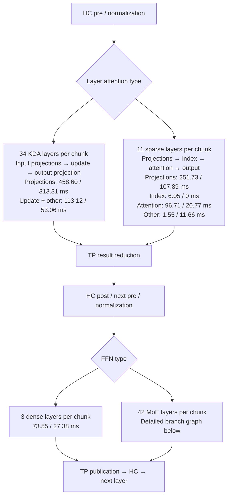

# GLM execution graph with measured stage weights

Historical trace only. The current scales + bulk artifact now has a bounded
first-chunk trace in [the current execution graph](GLM_SCALES_BULK_EXECUTION_GRAPH_2026-10-19.md),
including complete observed layer-collective counts. Do not reuse the old
weights below as current costs. The native MoE fork/join edge below is corrected:
both partial producers join before TP packing/reduction, not only at the final
MoE combine.

This is an offline reading of retained execution traces and the selected
source, not a new overall benchmark. No new GPU workload, model hash or
integrity scan was run to construct these graphs.

## Measurement boundary

Compare the same first twelve 64-token prefill chunks, rank 1 of TP2, from
the retained 7973-input-token request. Numbers below are summed **GPU kernel
durations in milliseconds**, not HTTP latency or additive critical-path time.
The graph collapses repeated layers; its boxes are not a scaled time axis.

- LunaFlux capture: historical `cbffec1f` latent-cache path, packed-row experts,
  single-partition scale scans and ordered KDA. The interrupted capture has
  twelve complete embedding-to-embedding intervals. The final incomplete
  interval is excluded. Gate/up and down each have 504 observed calls.
- Reference: installed vLLM `487ecf187`, actual selected CUTLASS experts and
  FlashInfer sparse kernels. Only its first twelve chunks are used here, not
  the full 125-chunk sum. Local `../vlm` alone is not the installed GLM branch;
  use the installed snapshots where they differ.
- Native collective coverage is incomplete: 149 records, not the expected
  full sequence. Native idle time, communication total and full critical path
  therefore remain **unknown**. A missing event is not proof of an idle GPU.
- The newest qualified candidate uses expanded cache, 32 scale partitions and
  bulk experts. It has no corresponding complete stage trace. These old
  weights cannot be relabelled as that candidate's remaining bottlenecks.
- Different profiler modes and the interrupted native capture limit causal
  speedup claims even within the matched prefix. This is observed execution
  accounting, not a prediction from an isolated kernel ratio.

## Attention and layer sequence

Each timing pair is **LunaFlux / vLLM**. There are 34 recurrent and 11 sparse
attention layers per chunk, followed by 3 dense and 42 MoE FFN layers across
the model. These are alternatives at each layer, not concurrent attention
branches. Projection buckets include both input and output projections.

Across the repeated boundaries, HC totals are **116.314 / 44.500 ms**.
vLLM's recorded collectives total **188.463 ms** for 1104 calls (including
embedding/head collectives), not a cost belonging to just one TP box above.
Native has only 97.361 ms of recorded collective kernels; its incomplete
coverage forbids interpreting that as a smaller communication cost.

Reference index scoring/selection is absent in this early window: its
context<=topK branch bypasses those kernels. This does not mean index scoring
is free for long history. In the full 125-chunk reference it appears in 93
later chunks, totaling 22.690 ms for score plus selection.

The sparse attention algorithms are not the same work decomposition. Native
groups sixteen queries per head, traverses history for QK, then applies each
query's membership mask. The reference assigns one query and a head group to
a CTA, splits its selected list, and gathers selected KV before QK/PV. The
same full-history traversal also exists in the current expanded-cache native
artifact, but the old latent kernel's 96.71 ms is not its current timing.

## MoE graph: preserve the parallel shared branch and TP ordering

The following weights sum over 504 MoE invocations in the matched window.
The preparation labels include actual quantization and row layout work, not
GEMM time. Shared-expert weights use interval union to avoid counting its own
overlapping kernels twice.

```mermaid
flowchart TB
    subgraph L["LunaFlux — historical captured path"]
        LX["FFN input"] --> LR["Router<br/>72.08 ms"]
        LX --> LS["Shared expert, auxiliary stream<br/>762.32 ms union<br/>757.40 overlapped; 4.92 uncovered"]
        LR --> LP["Group + input scale + quantize + pack<br/>107.03 ms"]
        LP --> LG["Routed gate/up<br/>1194.57 ms"]
        LG --> LA["Activation scale + quantize + repack<br/>401.93 ms"]
        LA --> LD["Routed down<br/>562.37 ms"]
        LD --> LT["TP pack → collective → unpack<br/>Pack/unpack: 52.92 ms<br/>Collective time incomplete"]
        LT --> LF["Routed finalize + MoE join<br/>8.90 + 3.55 ms"]
        LS --> LT
        LF --> LO["HC / next layer"]
    end
    subgraph V["vLLM — same first twelve chunks"]
        VX["FFN input"] --> VR["Router<br/>45.16 ms"]
        VX --> VS["Shared expert, auxiliary stream<br/>86.06 ms union<br/>39.06 overlapped; 47.00 uncovered"]
        VR --> VP["Quantize + maps + expand + strides<br/>24.85 ms"]
        VP --> VG["Routed gate/up<br/>872.65 ms"]
        VG --> VA["Activation / requantization<br/>7.35 ms"]
        VA --> VD["Routed down<br/>474.23 ms"]
        VD --> VF["Routing finalize<br/>8.89 ms"]
        VF --> VJ["Join / remaining routed glue<br/>1.94 ms"]
        VS --> VJ
        VJ --> VT["TP collective → HC / next layer"]
    end
```

Edges express dependency, not a claim that each shared branch starts at the
same timestamp as routing. In the actual first-chunk layer-3 trace, native
shared gate/up starts 0.113 ms after router start; reference shared work starts
2.385 ms after router start, near the tail of its routed gate/up. Overlap is
measured from GPU timestamps, not inferred just because a second stream exists.
Uncovered shared time is not automatically removable wall time; overlapped
work can still compete for resources.

### Preparation bucket reconciliation

The native 574.332384 ms routed-glue bucket decomposes exactly into:

| Recorded operation | First-twelve-chunk sum, ms |
|---|---:|
| Group rows | 16.724384 |
| Input global-scale scan | 81.260384 |
| Input quantization | 3.357152 |
| Input row packing | 5.690656 |
| Activation global-scale scan | 394.713824 |
| Activation quantization | 5.007360 |
| Activation row packing | 2.207200 |
| TP packing | 26.569760 |
| TP unpacking | 26.348288 |
| Routed combination | 8.903136 |
| MoE combination | 3.550240 |

Both scans have 504 calls, not the 546 calls from the older thirteen-pass
leaf table. They total 475.974208 ms of the twelve-pass preparation cost.
That is measured evidence of the old schedule's cost. The new 32-partition
schedule has already changed that work distribution; its remaining time
must be measured separately before another bottleneck claim.

Reference routed glue totals 43.027127 ms: quantization 14.165342, expert maps
3.733536, row expansion 4.954169, strides 2.000160, activation 7.345056,
finalization 8.887104, remaining elementwise/join 1.941760. Its quantization
still has online block work; loaded global scales do not mean no quantization.

## Actual timestamp example, not a fabricated proportional timeline

First chunk, layer 3, main routed branch. Times are milliseconds from each
engine's own router start; the clocks are not aligned across engines.

| Phase | LunaFlux interval | vLLM interval |
|---|---|---|
| Router envelope | 0.000000–0.152928 | 0.000000–0.047168 |
| Input preparation envelope | 0.153056–0.379552 | 0.047040–0.242688 |
| Routed gate/up | 0.379648–3.450688 | 0.259552–2.445440 |
| Activation/requantization envelope | 3.450560–4.328800 | 2.485056–2.543232 |
| Routed down | 4.328928–5.817088 | 2.508640–3.681376 |
| TP pack | 5.816928–5.873728 | not a separate counterpart |
| Unattributed interval before native unpack | 5.873728–6.684736 | not comparable |
| TP unpack | 6.684736–6.742912 | not a separate counterpart |
| Routed finalize | 6.742752–6.759776 | 3.680992–3.701024 |
| Reference recorded all-reduce | missing in this native slice | 3.708832–3.869472 |

Small adjacent timestamp overlaps occur even on the same recorded stream;
retain them rather than imposing a fabricated strictly serial timeline.
The native 0.811008 ms interval above must not be labelled GPU idle or a
measured NCCL wait: that part of the collective capture is missing.

## What the graph establishes

The old matched-prefix excess is distributed across preparation, routed
matrix work, projections, recurrent work and sparse attention. It is not
explained by adding the entire shared branch to the main path. The largest
old duration deltas are routed glue +531.305 ms, gate/up +321.918 ms, KDA
projections +145.294 ms and sparse projections +143.835 ms. These are
category-duration differences, not additive causal wall-time contributions.

The latest candidate already changes preparation and gate/up transport. Its
remaining per-stage allocation is unknown, so this report does not use the
old graph to claim those exact costs remain. A future current-path trace must
retain matched chunk/history IDs, constituent graph nodes, both TP owners,
communication boundaries and bounded host memory. No new overall benchmark
is needed to make that next stage attribution meaningful.

## Evidence and reproducibility

All attribution stays outside the compiler. Source-to-execution details are
in `GLM_HTTP_EXECUTION_QUALIFICATION_2026-10-19.md` and
`GLM_QUANTIZED_INDEX_CACHE_2026-10-19.md`.

- Native SQLite: `/tmp/lunaflux-glm-http-latent-egress-trace-20261019-v2/rank1.sqlite`.
- Native twelve-pass allocation: `/tmp/lunaflux-glm-native-partial-long-analysis-20261019-v2/{summary,passes}.json`.
- Reference SQLite: `/tmp/lunaflux-reference-bench-glm-long-egress-trace-20261019-v2/rank1.sqlite`.
- Reference region allocation: `/tmp/lunaflux-glm-vllm-long-pass-analysis-20261019-v4/regions.json`, filter `pass < 12` before summing categories.
- Reference HC/collective window: first `mhc_pre_big_fuse_with_norm_tilelang_kernel` up to, but excluding, anchor 1080 (90 anchors per chunk).
- Reference first-twelve kernel union 2278.562697 ms; nonshared union 2231.557798 ms; shared union 86.061820 ms. Intersection is 39.056921 ms, shared-only time 47.004899 ms.
- Native full-window shared union 762.320224 ms; intersection 757.399552 ms; shared-only time 4.920672 ms.

Read-only SQLite window queries and existing MoonBit analyzers produce these
numbers. No payload hash, regenerated reference or new tolerance is involved.
