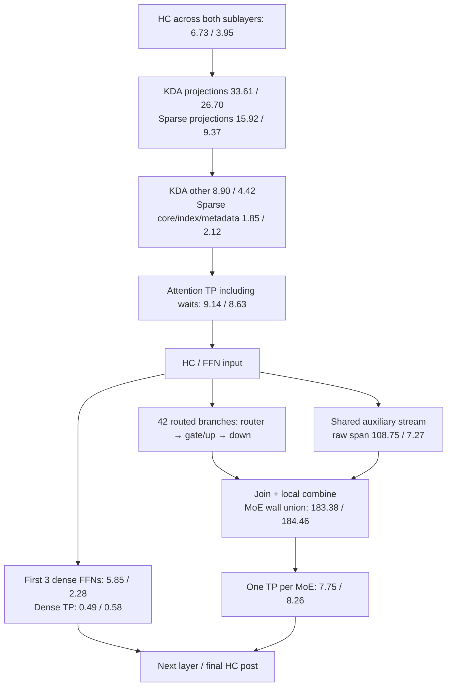

# Filtered latest-path two-rank execution trace

## Result and scope

The **native two-rank cold/warm retrace is complete and lossless**. The fresh
vLLM attempt did not reach readiness: its 18 GiB early host-headroom guard
requested retirement during checkpoint loading. Therefore the reference column
below is explicitly the retained **October 19 rank-1 trace**, not a new paired
vLLM capture. No new vLLM rank-0 or paired reference TP attribution is available.

One complete 64-token chunk, all 45 decoder layers, first HC pre through final
HC post; embedding/head/sampling/HTTP are excluded and the next-chunk handoff is
reported separately. This is **not an overall benchmark**. The finite campaign
was one native cold/warm run and one fresh reference load/capture attempt.
No additional full-model retries or payload hashing were performed.

Native runtime: accepted `ed6be466`, qualified `b1788d1d` projection AOT. Exact
configuration retains rows64, slots8, context8192, history-pages513, admission
lanes16, scales+bulk experts, local-combined BF16 MoE TP, BF16 projection TP and
16-site exact-capacity graph windows. The selected large sparse output has the
swizzled fragment pipeline; other projections retain their qualified selectors.
Index scoring is row-scaled E4M3 matrix; the selected sparse cache remains
expanded BF16, not the packed-cache experiment.
Ordered-token KDA remains selected; the unsafe chunk-KDA workspace alternative
is not silently enabled. Compiler/source presence is not the selection proof:
the reused manifests, source-qualified artifacts and actual kernel/graph records
are retained with the capture.

## Completeness and observer limitations

Root: `/tmp/lunaflux-glm-http-filtered-20261021-v1`.
Collector: `/tmp/lunaflux-activity-20261021-v8`, external CUPTI13.0.1 injection.
Both windows contain a full 90-HC-entry/90-reduction decoder chunk on each rank;
all 42 MoEs contain their gate/up and down pair. Both HTTP responses contain
7,973 uncached prompt tokens, one completion token and SSE completion. The
separate post-capture arithmetic request returns `323`, `finish_reason=stop`.
One-token request completion is not a broader model-quality qualification.
“Cold” means the first literal long prefill after startup and the short warmup;
“warm” means a second identical but uncached long request, not prefix reuse.

Terminal records: rank0 **14,531**, rank1 **23,395**; both have zero dropped,
refused, invalid or error records after explicit final sealing. These totals
cover both windows, not only the selected first chunk. The previous polling
record overflow is resolved for this actual full-model capture, not merely a
fixture. The control windows are bounded but start/stop RPC and snapshot delays
make their actual spans longer than the nominal700ms timer; analysis uses
observed decoder boundaries, not that nominal duration.

The filter removes context-bind/event-query/stream-query API records before
allocation. GPU events, launches, transfers and explicit waits remain. It cannot
assign per-poll CPU time. CUPTI buffers use 8MiB fixed host storage and four1MiB
device buffers; this is not a claim about all driver-internal memory.
Copies have no exported direction field; their presence/intervals are preserved.
No fresh hardware-counter or CPU scheduling capture was performed here.

Selected first-chunk rank1 examples: `glm_sparse_3_output`, grid1024/block128,
0.340014ms; `glm_routed_3_gate_up`, grid48/block288,2.321666ms; corresponding
down, grid48/block288,1.063725ms. They execute as graph nodes. There are six
collective graph-launch correlations across the 90 decoder reductions.

## Execution dependencies and time allocation

Numbers in this graph are **sums across the selected chunk**, not one layer.
Pairs are native cold rank1 / retained vLLM rank1, in milliseconds. HC and
projection labels use the disjoint allocation below; raw shared spans are
marked separately and must not be added again.

The topology repeats per layer; the dense and MoE boxes are alternatives at
different layers, not two simultaneously executed FFNs. No compute/TP kernel
overlap is observed in either selected decoder trace.

### Disjoint decoder wall allocation

Overlapping categories count once. The rows sum to decoder wall time; kernel
sums do not. Reference engine `487ecf187`, NVFP4/TP2, same rows64 workload,
uses FLASHINFER_CUTLASS experts and its selected chunk-KDA/sparse path. Its
installed dispatch/source and SASS provenance remain documented in
`GLM_LATEST_EXECUTION_GRAPH_2026-10-20.md` and
`GLM_FRAGMENT_PIPELINE_2026-10-21.md`; `../vlm` alone is not proof of execution.

| Stage, ms | Native cold R1 | Retained vLLM R1 | Difference |
| --- | ---: | ---: | ---: |
| KDA projections | 33.609127 | 26.704800 | +6.904327 |
| Sparse projections | 15.917085 | 9.372864 | +6.544221 |
| HC | 6.732444 | 3.950080 | +2.782364 |
| KDA non-projection | 8.899502 | 4.422656 | +4.476846 |
| Dense FFNs | 5.849460 | 2.281952 | +3.567508 |
| TP including waits | 17.384319 | 17.468992 | -0.084673 |
| MoE including overlap | 183.380831 | 184.459176 | -1.078345 |
| Sparse core/index/metadata | 1.845932 | 2.116095 | -0.270163 |
| No recorded kernel | 0.858760 | 5.255609 | -4.396849 |
| Small cross-family overlaps | 0.009472 | 0.038464 | -0.028992 |
| **Decoder wall** | **274.486932** | **256.070688** | **+18.416244** |

This is 7.1919% more decoder time against the retained reference. Projections
account for13.448548ms of the net18.416244ms difference; positive and negative
rows offset, so this is not a guaranteed gain from one optimization. The old
native290.090304ms capture is also historical. Different capture dates and
observers prevent a clean causal before/after speedup claim. No updated tok/s,
complete-request latency or fresh matched vLLM result is implied.

### Both ranks and overlap

| Native selected chunk, ms | Cold R0 | Cold R1 | Warm R0 | Warm R1 |
| --- | ---: | ---: | ---: | ---: |
| Decoder wall | 274.493138 | 274.486932 | 275.225663 | 274.911764 |
| TP kernel union | 17.494421 | 17.384319 | 17.644548 | 16.866775 |
| Shared overlapping other compute | 108.290674 | 108.654136 | 109.028915 | 108.552931 |
| Shared not covered by other kernels | 0.092447 | 0.092518 | 0.093023 | 0.098787 |
| Compute/TP overlap | 0 | 0 | 0 | 0 |
| Next-chunk handoff wall | 2.478640 | 3.177350 | 2.094203 | 2.247773 |
| Handoff without recorded device activity | 2.147384 | 2.841113 | 1.759776 | 1.891501 |

Retained vLLM shared span7.273535ms overlaps other compute3.212895ms and has
4.060640ms uncovered. Native shared compute is much heavier but mostly hidden
behind routed work. This does not prove it is free: SM/bandwidth contention
could lengthen the routed branch, which requires a separate controlled test.
Native cold R1 router/gate-up/down raw sums are5.897460/116.932243/53.866651ms;
reference3.718173/112.605934/61.313952ms. Do not add the shared raw sum to them.

The retained reference handoff is4.011232ms,0.224352ms uncovered. Its head does
more work in this intermediate chunk; it is not a pure scheduler comparison.
The current native handoff is much smaller than the old8.29ms observation, but
the changed observer and idle runtime prevent assigning all of that difference
to the idle-wait repair. Kernel/copy-free spans do not identify a CPU cause.

## TP waits, not assumed wire time

All90 reductions are paired in order. Cross-host clocks are not assumed aligned;
mutual start-before-peer-completion constraints bound their offset. The interval
width is0.248483ms cold and0.260597ms warm. This is too wide to precisely divide
every approximately0.18ms reduction into peer waiting and communication.

- First two dense-FFN reductions, cold R0:0.182588/0.179965ms;
  cold R1:0.190888/0.156902ms. Warm R1:0.188520/0.165510ms.
- First cold attention reduction: R0 duration1.063692ms, with
  0.197924–0.446407ms bounded early arrival; R1 duration0.723711ms and no
  early arrival within the feasible offset interval.
- Across all selected cold sites, the largest rank0 completion tail after both
  starts is bounded0.617285–0.865768ms; rank1's largest is0.723711ms.
  Warm upper bounds are0.345818ms/0.336558ms. The old3ms post-both-start stall
  is absent from these selected captures.
- Early-arrival totals remain broad: cold R0 0.979381–12.245896ms,
  R1 1.007391–12.104346ms. Do not present the remainder as measured network
  wire time. Protocol, proxy, synchronization and GPU scheduling can contribute.
- Graph-node correlations identify a whole graph launch, not separately
  submitted collectives; individual launch-lead attribution remains null.

The retained reference has only rank1. Its17.468992ms TP total includes waits;
there is no paired clock bound or defensible fresh network comparison for it.

## Fresh vLLM attempt and memory

Root: `/tmp/lunaflux-reference-bench-glm-filtered-20261021-v1`. Same cached
image/version/checkpoint, TP2, context8192, max-sequences8, batch64, KV256MiB,
graph capture maximum8; no eager fallback or capacity change. Activity is not
enabled until readiness. The loader reported181.30GiB checkpoint/19.38GiB
available RAM and only six of121 shards completed before paired retirement.
No request/capture window was started.

The fast guard's last rank0 observation is18,839,880KiB =17.967110GiB, below
its18GiB early-stop threshold, **not below the user's16GiB floor**. Both stopped
containers report137 after requested shutdown; that is not proof of an OOM.
The final wrapper reports generic `CommandFailed` because the concurrent owner
watch sees retirement as failure; preserve the raw reserve/stop/terminal logs.
This attempt does not establish that an unprofiled vLLM load could never fit16GiB;
it establishes that this configured attempt was stopped safely before readiness.
Do not relax the guard or rerun unchanged to manufacture a fresh result.

Sampled envelopes (not continuous physical maxima):

| Run | GPU max R0/R1, GiB | Host minimum R0/R1, GiB |
| --- | ---: | ---: |
| Native trace | 94.241 / 94.270 | 17.093 / 18.962 |
| Failed fresh reference load | 89.628 / 89.628 | 17.967 / 19.127 |
| Accepted GLM restoration | 94.239 / 94.268 | 17.178 / 19.260 |

Native owned swap remains zero. Reference containers were configured with
96GiB memory and96GiB memory+swap, disallowing additional swap. No global swap
clear, cache drop, checkpoint integrity scan or payload digest was used.

## Evidence and restoration

Native root contains raw rank activity, clean FINAL lines, cold/warm SQLite,
`rank{0,1}-{cold,warm}-first/{summary,regions,leaves}.json`, paired TP bounds,
handoff reports, requests/responses and memory watches. Decimal timestamps are
kept lossless. `allocation-and-tp-v2.json` is the compact derived report; v1's
redundant tuple-valued presentation is retained rather than overwritten.
Temporary orchestration/aggregation is MoonBit `.mbtx`, outside the compiler.
Offline converter/execution/paired-TP/handoff tests pass6/6. No production or
kernel implementation changed this turn, so no new kernel sanitizer or full
repository-suite success is claimed.

GLM is restored on both accepted `ed6be466` units, active with100GiB memory
caps and zero allowed/observed owned swap. Private backend health is healthy;
the complete post-restoration arithmetic answer is `323`, finish reason `stop`.
Root: `/tmp/lunaflux-glm-filtered-restoration-20261021-v1`, including startup
memory observations, before/after unit states, health and answer. No customer-key
public-route requalification is claimed. The temporary reference containers
are retired; no diagnostic GPU owner remains.

Fresh paired vLLM capture remains incomplete because the configured loader
attempt hit early headroom protection. The next prerequisite is bounded loader
peak-memory qualification without changing the measured model/workload; it is
not another unqualified trace or a lower reserve. The native tracing part is
complete. Comparison and the observer remain outside the compiler.
