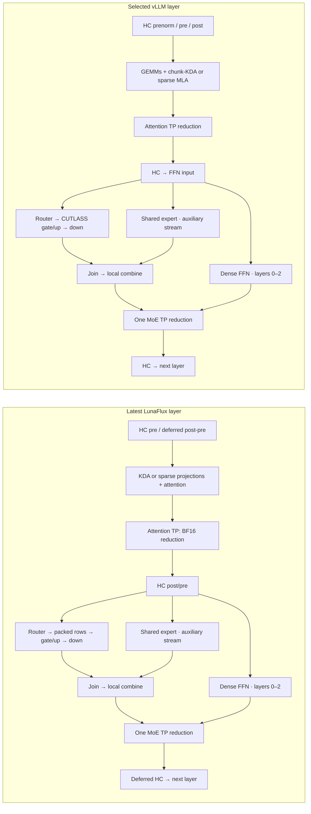

# Latest selected GLM execution graph: time, overlap and TP waits

## Result and exact scope

Fresh **both-rank, cold/warm** traces cover a complete first 64-token decoder
chunk: 45 layers, 90 HC entries and 90 decoder all-reduces. This extends the
previous prefix-only capture. It is **not an overall benchmark** or a timing
estimate for all 7,973 input tokens.

For rank 1, the first cold decoder chunk is **290.090304 ms**, versus
**256.070688 ms** in the retained matching vLLM trace. Projections account for
**23.454848 ms of the 34.019616 ms observed decoder difference**. This is
disjoint trace accounting, not a promise of that much speedup from a rewrite.
The previous repeated 3 ms early-TP stall does not reproduce in this latest
windowed path. A separate inter-chunk host/submission boundary remains visible.

No production code, numerical contract or default policy was changed. Two
external MoonBit trace analyzers were added; comparisons do not enter the
compiler. No payload hashes or integrity scans were performed.

## What actually executed

The latest committed runtime implementation is `6c10bf37`; HEAD before this
capture was `0b0ccfe4`. Intervening commits add tests, external observation and
documentation, not a newer executable implementation. The traced ARM executable
is `/tmp/lunaflux-glm-service-arm-windows-20261020-v1/glm_service.exe`.
Qualified projection-TP artifacts were reused, without recompilation or hashing.

| Selection | Actual latest trace |
| --- | --- |
| Physical chunk / resident slots / context | 64 / 8 / 8192 |
| Admission lanes | 8 for profiling, versus 16 in the restored service |
| Index scoring | Row-scaled E4M3 matrix |
| Sparse attention / cache | Tiled F32 accumulation / expanded BF16 |
| KDA | Ordered-token F32 |
| Projection staging | Synchronous |
| Expert staging | Bulk tiles: 128 columns, two consumer teams, 48 workers |
| Expert activation-scale scan | 32 partitions |
| MoE TP | Local combined BF16, then one reduction |
| Non-MoE projection TP | BF16 after rounding |
| Prefill graph submission | Exact-capacity, maximum 16 collective sites per window |

`service-0.json`, `service-1.json` and the actual startup journals in the raw
root record these selections. Six graph-launch correlations contain the 90
decoder collective nodes, proving windowed execution rather than mere policy
presence. Selected `glm_routed_3_gate_up` and `_down` use 48 CTAs of 288 threads;
the scale scan uses 32 CTAs. The sparse score matrix symbol and retained-score
attention symbol execute, rather than the old serial score route.

“All optimizations” cannot mean enabling unqualified alternatives together.
Chunk-triangular KDA at this eight-slot/8K capacity requires another
2,709,520,384 planned bytes; the documented base reserve forecast becomes
15.05 GiB, below the required 16 GiB. It remains excluded. Buffered projection
and latent-cache experiments are not silently promoted either. Thus this is
the newest compatible selected path, **not every experimental path**. Eight
slots also do not promise eight simultaneous full-8192 histories.

## Reference freshness and matching

vLLM evidence is retained from October 19:
`/tmp/lunaflux-reference-bench-glm-long-egress-trace-20261019-v2/rank1.sqlite`.
It is **not a new vLLM run**. The last fresh-load attempt was stopped at the
18 GiB early guard, with 17.95 GiB available, before readiness. Repeating that
unchanged load would not establish a safe comparison.

The comparison uses the same NVFP4 checkpoint, TP2, 7,973 input tokens, first
64-token chunk and 8192 context limit. vLLM uses `487ecf187`, the selected
FLASHINFER_CUTLASS expert backend and NCCL 2.30.7; native uses NCCL 2.31.2.
The reference output cap is two tokens versus one in this diagnostic, so no
whole-request comparison is made. Reference rank 0 was not captured; its
peer-arrival contribution cannot be reconstructed from rank 1 alone.

“Cold” means the first long request after startup and short decode warmup.
“Warm” is the same long request repeated in the same resident process. Both
report zero cached prompt tokens; this is not a cold-start latency experiment.

The decoder starts at native `glm_hyper_attn_0_square_tree_tiles_v1` or vLLM
`sm120_tf32_hc_prenorm_gemm_impl`, **including** the latter's initial prenorm
GEMM, and ends after the final HC post. The corrected reference analysis is
`...reference-first-20261020-v2`; the earlier v1 omitted that initial GEMM.

## Execution and overlap graph

These are repeated layer templates, not one long concatenation of all attention
then all FFN work. There are 34 KDA and 11 sparse layers; the first three FFNs
are dense and the remaining 42 are MoE. Times below the graphs are aggregates
over the complete first chunk, not timings of one representative layer.



Source verification uses the **installed** reference snapshot at
`/tmp/lunaflux-glm-selected-vllm-source-20261019-v3`, not an assumed path from
the different `../vlm` revision:

- `models-glm5next-nvidia-kda.py:571–581` selects chunk-KDA for prefill.
- `models-glm5next-nvidia-model.py:222` leaves shared output unreduced;
  `model_executor-layers-fused_moe-runner-moe_runner.py:410–487` describes
  the late combined reduction. The captured 90 collective sites verify the
  selected execution, rather than assuming every source branch runs.
- `model_executor-layers-fused_moe-runner-shared_experts.py:121–150` owns
  auxiliary-stream start/join. Actual timestamps determine overlap.

The corresponding native bulk source is retained at
`/tmp/lunaflux-glm-http-policy-combined-20261019-v1/rank1.cu`; selected symbols,
launch geometry and graph correlations connect it to this fresh capture.

## Non-overlapping decoder time allocation

Each row is **disjoint wall time**. Concurrent shared/routed intervals count
once in MoE; tiny cross-family overlaps are retained separately. This table
adds to decoder wall time, unlike a sum of kernel durations.

| First chunk, rank 1, ms | Latest cold | Retained vLLM | Native minus reference |
| --- | ---: | ---: | ---: |
| KDA projections | 38.537152 | 26.704800 | +11.832352 |
| Sparse-attention projections | 20.995360 | 9.372864 | +11.622496 |
| HC | 9.572480 | 3.950080 | +5.622400 |
| KDA non-projection work | 8.968352 | 4.422656 | +4.545696 |
| First three dense FFNs | 5.844672 | 2.281952 | +3.562720 |
| Decoder TP kernels, including waits | 19.134112 | 17.468992 | +1.665120 |
| MoE union, including shared overlap | 184.615776 | 184.459176 | +0.156600 |
| Sparse attention core, index and metadata | 1.832352 | 2.116095 | −0.283743 |
| No recorded kernel | 0.582496 | 5.255609 | −4.673113 |
| Cross-family overlap | 0.007552 | 0.038464 | −0.030912 |
| **Decoder wall** | **290.090304** | **256.070688** | **+34.019616** |

These categories are explicit selected-symbol classifications, not new IR
legality rules. KDA non-projection includes recurrence, gates, convolution and
other surrounding work; sparse metadata includes pooling/selection work.
Raw per-symbol and per-sublayer records accompany the summary.

| Raw MoE GPU spans, ms; do not add to the table above | Latest cold R1 | vLLM R1 |
| --- | ---: | ---: |
| Router kernel sum | 5.880352 | 3.718173 |
| Routed gate/up sum | 117.913760 | 112.605934 |
| Routed down sum | 54.277952 | 61.313952 |
| Routed glue sum | 6.411200 | 3.904733 |
| Shared-expert interval union | 108.612320 | 7.273535 |
| Shared overlapping other work | 108.467136 | 3.212895 |
| Shared uncovered by other work | 0.145184 | 4.060640 |

Most native shared work overlaps routed gate/up: **103.454304 ms**. Adding
108.6 ms of shared work again would invent a large critical-path cost.
Conversely, overlap does **not** prove shared work is free: SM/bandwidth
contention could lengthen the routed branch. That requires a controlled
ablation or selected-kernel counters, not inference from overlap alone.

Neither trace shows decoder compute kernels overlapping NCCL kernels in this
first chunk. Shared/routed overlap is present; compute/TP overlap is not.
Graphs reduce host submissions but do not remove the inter-layer TP dependency.

## Cold/warm and both-rank TP accounting

| Complete first decoder chunk, ms | Cold R0 | Cold R1 | Warm R0 | Warm R1 |
| --- | ---: | ---: | ---: | ---: |
| Wall | 296.657376 | 290.090304 | 297.452320 | 291.428416 |
| Compute interval union | 271.352416 | 270.373696 | 273.104670 | 270.838176 |
| NCCL interval union | 24.724640 | 19.134112 | 23.843072 | 20.122848 |
| No recorded kernel | 0.580320 | 0.582496 | 0.504578 | 0.467392 |
| Shared overlap | 110.021600 | 108.467136 | 109.674656 | 108.739968 |

Never add the two ranks' wall times. Native cold R1's TP splits into
8.228320 ms at KDA output, 1.522880 ms at sparse output, 0.482816 ms at dense
FFN output, and 8.900096 ms at combined MoE output. Reference R1's matching
values are 6.616512, 2.014016, 0.577600 and 8.260864 ms.

| Site, NCCL kernel span, ms | Cold R0 / R1 | Warm R0 / R1 |
| --- | ---: | ---: |
| First attention reduction, ordinal 0 | 6.774816 / 0.182784 | 6.247328 / 0.184096 |
| First dense FFN, ordinal 1 | 0.199968 / 0.162240 | 0.183648 / 0.172928 |
| Second attention, ordinal 2 | 0.164992 / 0.166272 | 0.169408 / 0.188416 |
| Second dense FFN, ordinal 3 | 0.177344 / 0.166080 | 0.187296 / 0.169248 |

Both-rank causality bounds the cold ordinal-0 early arrival on R0 at
**6.461760–6.712544 ms**, with 0.250784 ms clock-offset uncertainty. The warm
bound is **5.922944–6.181184 ms**, uncertainty 0.258240 ms. Therefore the long
R0 span is largely peer arrival, **not** that much wire transfer. No synchronized
host clock or identical collective-finish assumption is used.

The largest non-first cold collective is 0.621920/0.618464 ms. Warm R1 has
one 1.775520 ms collective at ordinal 86, layer 43 sparse output; R0 takes
0.140832 ms. R1's early-arrival bound is **1.514208–1.772448 ms**. Several
preceding R0 projections are slower in this capture (for example output
1.029440 versus 0.567264 ms). That is measured producer asymmetry, not evidence
of a new 1.8 ms network stall. Why those R0 kernels slowed is not established
by this timing capture alone.

No observed NIC error/retry/congestion counter increased. Those counters span
whole diagnostic requests and do not isolate per-collective wire latency.
This run has no custom proxy profiler; the earlier proxy-ingestion experiment
and its instrumentation limits remain in `GLM_NCCL_COLD_WARM_2026-10-20.md`.

## Do not hide the head / inter-chunk handoff

The decoder-only table excludes final normalization/head, output exchange,
metadata transfers and waiting until the next chunk's first HC. These are
reported separately, not discarded:

| Decoder end → next first HC, ms | Cold R0 | Cold R1 | Warm R0 | Warm R1 | vLLM R1 retained |
| --- | ---: | ---: | ---: | ---: | ---: |
| Wall | 3.421952 | 8.291808 | 3.575040 | 7.841024 | 4.011232 |
| Recorded device activity union | 0.327232 | 0.340736 | 0.338976 | 0.333280 | 3.786880 |
| Uncovered by recorded device activity | 3.094720 | 7.951072 | 3.236064 | 7.507744 | 0.224352 |

Native cold R1 has a 0.261664 ms logits all-gather, eleven four-byte D2H
status copies and fifteen small H2D metadata copies. Its two largest uncovered
intervals are **2.718304 ms** before the next metadata upload and
**5.056192 ms** after the upload before the next embedding kernel. Recorded
CUDA API activity includes 294 event queries and 399 context-set calls, but
their summed API durations do not explain the whole uncovered interval.
No CPU scheduling/transport trace in this capture identifies the entire cause.
“No recorded device activity” is not a claim that both GPUs are globally idle.

The native head kernel takes only 0.011456 ms here because this intermediate
prefill chunk has no active output rows; vLLM executes a 3.442560 ms head.
This is a work-selection difference, **not** a claim that the native full
vocabulary head is hundreds of times faster. The reference tail also contains
its next embedding reduction. First-HC-to-next-first-HC is consequently
298.382112 ms native cold R1 versus 260.081920 ms retained reference R1;
this remains one step boundary, not overall latency or throughput.

## What this establishes, and what it does not

1. The latest combined MoE/TP/window path actually executes. The old repeated
   early 3 ms TP stall is not the explanation for this complete-chunk gap.
2. Attention projections are the largest measured excess in this first chunk;
   HC, KDA non-projection and the first dense FFNs follow. MoE is the largest
   absolute cost, but its overlapped union is almost equal in this comparison.
3. Another visible gap sits **between** chunks. It must be traced through
   host completion/publication/submission, not relabeled as NCCL wire time.
4. First-chunk attribution cannot be multiplied by 125 to explain long-history
   prefill: routing, history-dependent sparse work and first-use effects vary.
   These captures do not contain a second complete native chunk. No latest
   instruction-count, occupancy or stall-counter claim is made here.

The next targeted investigation is projection source/schedule and selected
kernel counters, alongside CPU events for the inter-chunk boundary. This
report itself does not implement another speculative optimization.

## Resource limits, correctness smoke and restoration

Diagnostic maximum GPU allocation was **94.242188 / 94.270508 GiB**;
minimum sampled host availability **17.355957 / 17.457642 GiB**. All available
owned-unit swap readings were zero; three startup/retirement readings were
unavailable. No memory-floor waiver was made.

Both long requests completed: 7,973 input, zero cached, one output token and
`[DONE]`. A subsequent 17×19 check returned `323` with a normal stop. These
are retirement/answer smokes, not broad model-quality qualification.

Both diagnostic owners retired successfully. The previously qualified GLM
service was restored unchanged and `/health` returned healthy; another real
answer returned `323`, `stop` (26 input/four output tokens). Restoration
maxima were **94.190430 / 94.218750 GiB**; host minima
**17.806335 / 19.462208 GiB**. Available swap readings and both final unit
swap peaks are zero; five startup pairs of readings were unavailable. The
windowed experiment was **not** silently promoted to the public service.

## Evidence and reproducibility

- Fresh raw root: `/tmp/lunaflux-glm-http-latest-graph-20261020-v1`:
  four `rank{0,1}-{cold,warm}.sqlite`, requests/responses, selected runtime
  journals, memory/network logs, `paired-{cold,warm}-90.json`,
  `envelope-network-summary-v2.json`, `execution-graph-summary.json`, and
  `handoff-*.json`.
- Decoder reports: `/tmp/lunaflux-glm-latest-graph-{cold,warm}-rank{0,1}-first-20261020-v1`.
- Reference report: `/tmp/lunaflux-glm-latest-graph-reference-first-20261020-v2`.
- Restoration: `/tmp/lunaflux-glm-nccl-restoration-20261020-v3` and
  `/tmp/lunaflux-glm-latest-graph-restored-answer-20261020-v1.json.reply`.
- Native capture used CUDA graph-node tracing, a 450 ms capture gate and no
  custom proxy plugin. SQLite exports ran only after GPU diagnostic retirement.

External analysis commands, with new output destinations:

```sh
moon run scripts/analyze-glm-execution-graph.mbtx native TRACE.sqlite NEW_DIR 0
moon run scripts/analyze-glm-execution-graph.mbtx vllm REFERENCE.sqlite NEW_REF_DIR 0
moon run scripts/analyze-glm-step-handoff.mbtx NEW_DIR/summary.json NEW_HANDOFF.json
```

The analyzers reject incomplete 90-site chunks and preserve raw sums separately
from interval unions/disjoint allocation. Optional absent Nsight activity tables
are reported explicitly. Warning-denied script tests pass **3/3**, covering
overlap, clipping, gaps and lossless timestamp reading. Formatting and scoped
whitespace checks pass. No compiler/ABI boundary changed and no new full-suite
or sanitizer result is claimed; unrelated workspace edits remain untouched.
