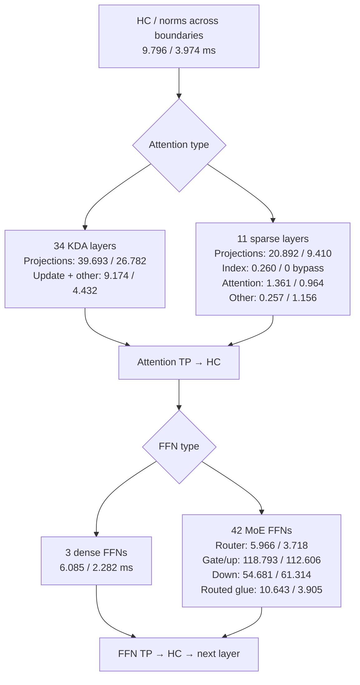

# Current GLM scales + bulk: measured execution graph

This is a new trace of the qualified **combined** artifact, not a relabelling
of the older latent-cache trace. No overall benchmark, payload hash, integrity
scan, compiler policy change or production kernel edit was performed. Trace
collection and analysis remain outside the compiler.

## What was actually captured

- Native artifact: `/tmp/lunaflux-glm-http-policy-combined-20261019-v1`, binary
  pinned to `72ce7bd1`. Expanded BF16 cache, row-scaled E4M3 matrix index,
  32 scale partitions, `bulk-tiles-128x2x48` experts. Ordered-token-F32 KDA
  and synchronous projection staging remain selected.
- Actual dispatch verifies scale grid 32 and bulk gate/up grid 48, block 288,
  static shared memory 78,368 bytes. Its source uses 32 producer and 256
  consumer threads with two slots. These are not the old expert launches.
- Same literal 7,973-input-token request, C1, physical prefill rows 64,
  context capacity 8,192, eight slots. One requested output token bounds the
  diagnostic; this is not an answer-quality or throughput test.
- Primary new capture: rank 1, software CUDA/node tracing, device-event
  tracing disabled, 500 ms requested collection timer. Collection command
  overhead extends the observed capture to about 693 ms.
- **One complete first 64-token chunk** is between consecutive embedding
  anchors. It includes all 45 layers, 42 gate/up and 42 down launches, 90
  reductions and one vocabulary gather. The final incomplete chunk is excluded.
- vLLM is the retained installed `487ecf187` trace of the matching request,
  checkpoint, TP2, chunk size and capacity, with the actual selected
  FlashInfer/CUTLASS kernels. Only its first chunk is used below. No new vLLM
  server or full benchmark was launched in this session.

The native long request was stopped by diagnostic memory headroom protection;
**late-history execution was not captured**. The profiler warns that some
events might be missing and reports eight incomplete events at collection
stop. Independent counts support the selected complete first-chunk region,
not completeness of the interrupted trace. There is no usable native rank-0
GPU trace, so peer-arrival delay cannot be separated from communication.

These are single observed execution windows, with different warmup/capture
states. Their stage allocations are evidence, not a stable speedup estimate.

## Whole-chunk allocation on the execution graph

Each pair below is **LunaFlux / vLLM GPU kernel-duration sum in ms** for the
first chunk, not additive wall time. Attention types are alternatives at each
layer, not parallel branches. HC spans the repeated boundaries of the model.



The latest native scale scans total **1.641984 ms**: input 0.285504 and
activation 1.356480, 42 calls each. They are already included in routed glue.
The old single-partition scan costs must not be used to describe this path.
Native down is not uniformly slower in this capture: its 42-call sum is below
the reference, although the first-layer example below is slower.

Early reference index scoring is bypassed while history is within top-K;
zero here does not mean no reference index work at long history. This first
chunk cannot establish which sparse-history component dominates near 8K.

### Overlap and collective accounting

| Measured first-chunk property | LunaFlux | vLLM |
|---|---:|---:|
| Collective kernel union, ms | 59.750560 | 17.670304 |
| Recorded reductions / gathers | 90 / 1 | 91 / 1 |
| **MoE-only collective union**, 42 calls, ms | **35.066048** | **8.260864** |
| MoE TP pack + unpack, 84 calls, ms | 4.394656 | no separate counterpart |
| Compute–collective intersection, ms | 0 | 0 |
| Shared-expert compute union, ms | 108.399360 | 7.273535 |
| Shared intersection with other compute/collective kernels, ms | 107.993247 | 3.212895 |
| Shared-only kernel coverage, ms | 0.406113 | 4.060640 |
| Uncovered by recorded kernels/copies, ms | 6.395712 | 5.330233 |

Shared work is almost entirely overlapped in LunaFlux. Adding 108.4 ms to its
serial path would be wrong. Overlapped work can still compete for resources;
this trace does not measure the counterfactual without that competition.
Neither engine overlaps compute with its recorded collectives in this window.

Native anchors are embedding-to-embedding, 148577104–492766928 ns
(344.189824 ms); reference anchors are HC-pre-to-next-chunk-HC-pre,
11675257888–11935337792 ns (260.079904 ms). These outer boundaries differ,
including one additional reference reduction. **Do not subtract these windows
as an exactly matched end-to-end gap.** MoE-only comparison uses 42 matching
FFN regions and excludes subsequent head collectives from the final region.

Native kernel union is 337.759200 ms despite summed kernel durations of
445.853791 ms. Including copies gives 337.794112 ms of recorded coverage.
Uncovered time is not automatically GPU idle, CPU overhead or avoidable delay.

## Actual first-MoE graph, with timestamps and fork/join placement

This is layer 3 in the first chunk, physical rows 64. Timestamps are ms from
each engine's own router start; clocks are not aligned between engines.
Arrows denote producer/consumer dependencies, not drawn-to-scale widths.

```mermaid
flowchart TB
    subgraph L["LunaFlux — CURRENT scales + bulk"]
        LX["FFN input"] --> LR["Router + input preparation<br/>0.000–0.219"]
        LX --> LS["Shared expert branch<br/>gate/up 0.106–2.103<br/>down 2.102–2.315"]
        LR --> LG["Routed gate/up<br/>0.219–2.638"]
        LG --> LA["Activation scale / quantize / pack<br/>2.638–2.715"]
        LA --> LD["Routed down<br/>2.715–4.107"]
        LD --> LJ["Join partial producers → TP pack<br/>4.107–4.170"]
        LS --> LJ
        LJ --> LT["9 MiB FP32 all-reduce<br/>4.174–4.977<br/>0.803 ms, includes peer wait"]
        LT --> LP["Unpack → publish → MoE combine<br/>4.982–5.070"]
    end
    subgraph V["vLLM — selected CUTLASS path"]
        VX["FFN input"] --> VR["Router + input preparation<br/>0.000–0.243"]
        VX --> VS["Shared branch starts later<br/>gate/up 2.385–2.497<br/>activation/down to 2.560"]
        VR --> VG["Routed gate/up<br/>0.260–2.445"]
        VG --> VA["Activation / requantization<br/>2.485–2.543"]
        VA --> VD["Routed down<br/>2.509–3.681"]
        VD --> VJ["Finalize / combine routed + shared<br/>3.681–3.707"]
        VS --> VJ
        VJ --> VT["0.5 MiB BF16 all-reduce<br/>3.709–3.869<br/>0.161 ms, includes peer wait"]
    end
```



The reference activation/down timestamp intervals overlap; preserve this
observation rather than inventing a fully serial schedule. The graph is a
logical dependency graph, not a claim that complete kernel retirement must
precede every downstream launch. Native graph-node stream IDs are 13/126;
do not infer branch identity from the old trace's main/auxiliary stream labels.

| First MoE measured operation | LunaFlux ms | vLLM ms |
|---|---:|---:|
| Routed gate/up | 2.419360 | 2.185888 |
| Routed down | 1.392096 | 1.172736 |
| TP packing + unpacking | 0.119168 | no separate counterpart |
| TP collective | 0.803072 | 0.160640 |
| Router-start to post-TP result ready | 5.069632 | 3.869472 |

The observed first-MoE envelope difference is 1.200160 ms. Its TP-kernel
difference is 0.642432 ms, plus 0.119168 ms of explicit native packing and
unpacking. These locate a substantial part of this particular interval's
excess, but are not a causal intervention or extrapolation to the full prompt.

## Why TP differs: actual source and payload, not a guessed bubble

Native `integration/packed_expert_mlp/program.mbt` constructs
`CoalescedSumPlan(left_width=hidden*selected, right_width=hidden)`.
`program_prepare.mbt` joins both producers **before packing and reduction**;
then unpacks and publishes routed/shared results before combining them.
Current emitted `rank1.cu:8528` uses widths 32768 and 36864:

```
64 rows × (8 routed partials + 1 shared partial) × 4096 × 4 bytes = 9 MiB
```

The installed vLLM runner's selected late-reduction path combines routed and
shared results before `_maybe_reduce_final_output`. The recorded collective
is `AllReduce_Sum_bf16_RING_LL`, on the combined hidden output:

```
64 rows × 4096 × 2 bytes = 0.5 MiB
```

Thus this native MoE boundary moves **18× the payload**, not 18× the measured
time. It also has separate pack/unpack passes and a different selected NCCL
protocol. The source agreement is checked against installed snapshots, with
`../vlm/vllm/model_executor/layers/fused_moe/runner/moe_runner.py` as the local
implementation counterpart (late reduction around lines 455–487, ordering
around 715–770). This is not an allegation that vLLM's arithmetic is the only
correct arithmetic: native explicitly preserves per-expert FP32 reduction
before rounding. Moving the sum/rounding boundary changes numerical order and
requires an explicit numerical/execution plan plus output-correctness testing.
This trace request did not make that compiler change.

## Submission and wait boundaries

The pinned HTTP service selects `CaptureDecodeCollectives` in
`cmd/glm_service/checkpoint.mbt`. `compiler/parallel_ir/submission.mbt:128–140`
enables collective-inclusive replay only for `live == 1`. The observed 64-row
prefill therefore uses compute-interval graphs and separate NCCL submissions,
not one collective-inclusive graph for the entire step.

In the current native window the runtime trace contains 92 `cuGraphLaunch`
calls and 91 `cuLaunchKernelEx` calls, consistent with those boundaries.
It also records 273 `cudaStreamWaitEvent` calls with 162.65 ms of summed CPU
API duration, and 132,498 `cuCtxSetCurrent` calls with 5.66 ms summed duration.
These are **profiled CPU API spans**, not another 168 ms of GPU idle time;
they can overlap GPU work, and instrumentation can perturb them. They must not
be added to kernel or collective time. The 6.40 ms uncovered GPU region is a
different measurement, not proof that all submissions are free either.

The collective GPU durations above include peer-arrival waiting and transport.
The rank-0 process launcher has an explicit environment allowlist in
`internal/process/process_approved_spawn.c`; Nsight's injection environment is
not forwarded to its exec child. Its parent trace consequently has no CUDA
events. **Wire time versus rank skew remains unallocated.** No host API duration
or blank trace has been substituted for that missing measurement.

## Failures, memory limits and restoration

All owned GPU units used `MemoryMax=100G`, `MemorySwapMax=0`; planned native
allocation was 103127137948 bytes/rank. This does not by itself reserve host
headroom for an external profiler.

1. `combined-hwtrace-v1`: profiler temp-directory permission failure; resolved
   with a task-owned TMPDIR, without modifying shared-directory permissions.
2. `combined-hwtrace-v2`: diagnostic client's warmup omitted Content-Length;
   HTTP 400, corrected in the external client. Not an inference-kernel failure.
3. `combined-hwtrace-v3`: platform reports CUDA hardware tracing unsupported
   and falls back to software; device-event tracing was enabled in that
   attempt. **Host reserve briefly fell to 15.56 GiB on .179 during shutdown**
   despite the early-stop guard. This violated the requested 16 GiB floor;
   this attempt is not the primary comparison and the violation is retained.
4. `combined-bounded-v4`: explicit software CUDA/node capture with device-event
   tracing off and a 500 ms timer. Lowest sampled host availability across both
   watcher files/ranks was **17796992 KiB = 16.9725 GiB**. Maximum sampled GPU
   usage was **96916 MiB = 94.6445 GiB**; owned units had zero swap. The 17 GiB
   diagnostic guard then retired the remaining long request. No late capture
   or other GPU job was started afterward.

The Nsight collection was stopped before report conversion. Reports were
exported only after diagnostic GPU owners retired; large raw reports remain
remote and only small SQLite exports were collected. Failed captures remain
available; no limits were raised or missing data invented to complete a graph.

**Production GLM was restored.** Both original user units are active; health
is healthy, and a fresh chat request for 17×19 returned `323`. Post-restoration
sampled host availability was 18480204 KiB on .178 and 20194184 KiB on .179,
with zero unit swap. No payload hashing was performed.

External launcher regression tests pass 4/4; the bounded controller and trace
collector pass MoonBit checks, and task-file formatting/diff checks pass. An
existing launcher `StringView.to_string` deprecation warning remains visible;
it was not suppressed. No new full native-suite or GPU-sanitizer result is
claimed: production compiler/kernel/ABI code was not changed in this task.

## Evidence and next measurement boundary

- Current capture: `/tmp/lunaflux-glm-http-combined-bounded-20261019-v4/rank1.sqlite`.
- Current categories: `/tmp/lunaflux-glm-combined-window-analysis-20261019-v2/{summary,passes}.json`.
- Current coverage/API spans: `/tmp/lunaflux-glm-combined-overlap-20261019-v1/`.
- Reference capture: `/tmp/lunaflux-reference-bench-glm-long-egress-trace-20261019-v2/rank1.sqlite`.
- Reference categories: `/tmp/lunaflux-glm-vllm-long-pass-analysis-20261019-v4/regions.json`, **filter pass == 0**.
- Reference coverage: `/tmp/lunaflux-glm-vllm-first-overlap-20261019-v1/`.
- Installed source: `/tmp/lunaflux-glm-selected-vllm-source-20261019-v1/`.
- External tools: `trace-glm-http-window.mbtx`, `trace-glm-long-http.mbtx`,
  `analyze-glm-native-long-passes.mbtx` in `partial` mode, and
  `analyze-gpu-overlap.mbtx`. No comparison enters numerical or compiler IR.

The proven current differences are payload/order at the MoE TP boundary,
substantial projection/HC/KDA work, and observable routed-matrix costs—not
the old long scale scans and not an entirely serial shared branch. The next
missing evidence is a **late-history bounded window plus both-rank collective
arrival/completion**, using a diagnostic child launcher that preserves the
existing wire descriptors and profiler injection, with measured profiler
headroom reserved before resident weights. Do not rerun an unrestricted
whole-request node trace or raise the 100/16 GiB limits. Until that evidence
exists, this report does not claim complete 8K critical-path attribution.

## Follow-up: local combination before TP (implementation plan)

The measured MoE boundary transports eight routed F32 partials and one shared
F32 partial per token. The alternative publishes each rank's expert results
locally, combines them into one BF16 hidden vector, then performs one BF16
sum-allreduce before HC. For 64 rows and 4096 channels this changes the
collective buffer from 9 MiB to 0.5 MiB and removes concatenation pack/unpack.

This is a different finite-precision program, **not** a bitwise-equivalent
reassociation. The numerical IR names the choice; the parallel plan joins both
producers before reduction; the device boundary carries the element type.
Both expert branches must be sharded, never replicated shared contributions.
Existing serving defaults remain unchanged during testing.

Qualification covers source/plan propagation, typed collective/fork boundaries,
bounded GPU correctness, complete answers, and retracing the same scales+bulk
workload against the retained matched vLLM trace. No overall throughput
campaign, payload hashing, or automatic promotion.
