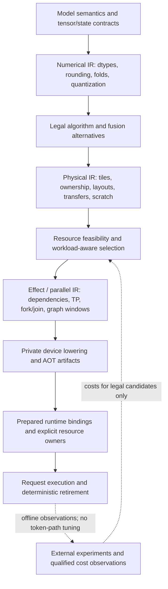
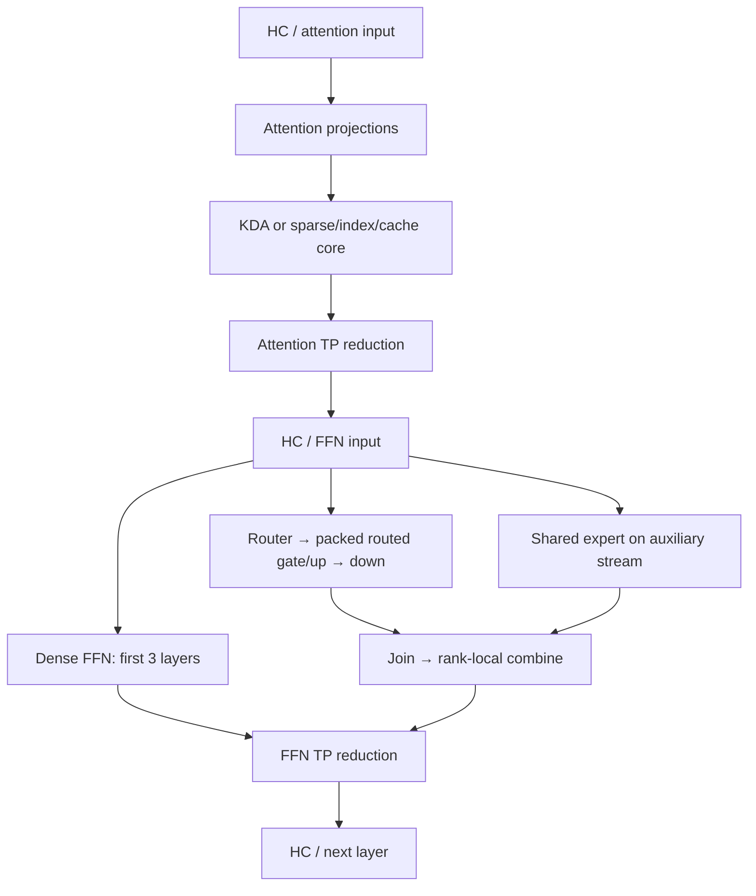

# Optimizing LunaFlux on two DGX Sparks

Written 2026-10-24. Evidence cutoff: the recorded 2026-10-22 campaign.

This is the engineering guide distilled from the project conversation and its
dated source, correctness, counter, trace, and serving reports. It covers Qwen,
DeepSeek, GLM, and MiniMax, with GLM providing the latest two-rank evidence.
It is not a new benchmark, a claim that every old experiment was rerun, or a
live inspection of the machines on October 24. Historical conclusions below
retain their workload and validation limits.

The complete document is organized into three linked parts:

- This guide: objectives, architecture, correctness, resources and trace reasoning.
- [Implementation and measurement playbook](TWO_SPARK_KERNEL_PLAYBOOK.md): kernel
  recipes, loading diagnosis, workload protocol and operational tool index.
- [Experiment history and latest measurements](TWO_SPARK_PERFORMANCE_HISTORY.md):
  successful fixes, rejected hypotheses, open gaps and supporting reports.

## 1. The objective and the central lessons

Optimize **useful, correct work completed under a resource budget**, not kernel
count, occupancy, instructions, bytes, or compiler-layer count in isolation.
The useful work can be a fixed token sequence, an answer meeting a task's
requirements, a diffusion trajectory, or a qualified serving workload. State
which one before making a performance claim.

The history establishes ten practical rules:

1. **Verify execution before diagnosing it.** Async attention existed while the
   serving bundle selected sync; optimized checkpoint paths existed while HTTP
   still selected older policies. Export, binding, and execution all matter.
2. **A workload change can expose a different algorithmic problem.** The roughly
   10% short-prompt GLM gap and 5.90× long-prefill gap were not the same test.
3. **Find avoidable critical-path cost.** A large shared-expert span may overlap
   almost entirely; a smaller projection difference may dominate the excess.
4. **Source suggests mechanisms; interventions establish causes.** Neither a
   counter label nor a nearby source difference is sufficient by itself.
5. **Count supporting work.** Addressing, operand conversions, fragment moves,
   duplicate scoring, metadata, waits, and publication can dominate the math.
6. **Reduced work is necessary evidence, not a speedup guarantee.** The latest
   wider projection halved L2 reads without a qualified timing improvement.
7. **Parallelism has several levels.** Threads, warps, CTAs, expert rows,
   independent branches, ranks, and requests solve different bottlenecks.
8. **Numerics and state are contracts.** Matching vLLM is not a proof of
   correctness; changing arithmetic is not an exact scheduling rewrite.
9. **Startup and observation must fit too.** A model that fits in steady state
   may fail during unpacking, dummy profiling, graph warmup, or tracing.
10. **An optimization is finished only at its intended boundary.** A passing
    leaf, selected service path, successful trace, complete answer, and restored
    endpoint are different milestones. Do not substitute one for another.

For matched work, define latency ratio `r = T_LunaFlux / T_reference` and excess
latency `(r - 1) * 100%`. Throughput ratio is `1/r` only when completed work is
equal. A 20% throughput increase needs time `T/1.2`, not `0.8*T`. For a serial
fraction `f` accelerated by `s`, the ideal time ratio is `(1-f)+f/s`; use the
actual dependency graph when work overlaps. Potential savings do not add when
they remove the same work or alter each other's bottleneck.

## 2. Two Sparks: topology, ownership, and the real memory budget

The historical compute pair is `.178` and `.179`, each a GB10/sm121 Spark,
connected through ConnectX-7. The management node and public routing are not
GPU workers. Addresses and controller state must be rechecked before a future
campaign; old SSH sockets and temporary run roots are not durable configuration.

Two devices are **two separately bounded memory domains**, not one transparent
242 GiB allocation and not an assumed NVLink connection. ConnectX-7 hardware
alone does not prove that the selected NCCL transport uses RDMA or achieves a
particular bandwidth. Record the installed transport, NIC, interface, route,
link state, NCCL version, channel configuration, and actual logs.

There are three distinct communication paths:

| Path | Purpose | How to assess it |
| --- | --- | --- |
| Public HTTP/TLS gateway | Client admission, streaming, routing | Client/server timestamps, serialization and queueing |
| Rank control channel | Submit, completion, cancellation, lifecycle | CPU/control events and explicit ownership boundaries |
| GPU tensor collectives | TP reductions/gathers | Actual NCCL kernels, both ranks, proxy/network progress |

Do not attribute an NCCL wait to HTTP TLS or assume removing control security
changes GPU transport. Keep LunaNexa deployment/routing outside LunaFlux's
compiler and scheduler. LunaFlux owns one inference instance, not the fleet.

### Required bounds

For the current large-model campaigns: **at most 100 GiB per Spark, at least
16 GiB host `MemAvailable`, and no owned swap**. Both limits apply independently.
The operating system reported roughly 121 GiB usable in this history; advertised
memory is not entirely available for model data. Older small-model campaigns
used stricter 64 GiB/32 GiB envelopes; preserve those historical distinctions.

Spark's CPU and GPU allocations compete for unified physical memory. Do not
blindly add GPU-reported bytes to process RSS: some accounting overlaps. Also
do not treat a cgroup limit as measurement of every GPU/driver allocation.
Observe all of the following, with units and sample intervals:

- Per-rank planned resident, transient, retained-state, graph, and trace bytes.
- GPU process memory, allocator live/reserved/peak values where available.
- Host `MemAvailable`, process RSS/PSS and anonymous/file-backed breakdown.
- Owned cgroup memory, peak, swap, exit reason, and the earlier stop threshold.
- Both ranks, including a lagging loader or rank exiting unexpectedly.

Use an early stop margin above 16 GiB, chosen to cover sampling and shutdown
latency. Record it separately. A stop at 18.5 or 19 GiB is **not an OOM** and
does not establish that the engine cannot fit at the user's 16 GiB floor.
Sampled maxima/minima are not proofs of continuous physical extrema.

Budget every phase, not just inference:

```text
process startup → checkpoint maps/read buffers → rank-local repacking/upload
→ model resident → dummy profile → compilation/workspaces → graph capture
→ cold request → warm requests → drain → release → service restoration
```

Weights include low-bit payloads, scales, padding, repacking copies and alignment.
KV includes actual representation and page rounding. Workspaces include all
simultaneously live layers/slots, not only one kernel's scratch. Graph objects,
drivers, pinned buffers, model loaders, compilers and observers need headroom.
Take the maximum live set over phases; do not sum non-overlapping allocations
or omit allocations that overlap while one phase hands off to another.

For ordinary dense KV, a first estimate is
`2 * layers * live_tokens * local_KV_heads * head_dimension * bytes_per_element`.
This is not the GLM/DeepSeek capacity formula: hybrid recurrent state, compressed
latent caches, pooled index keys and scales require their own terms. TP only
divides tensors actually sharded. In the Qwen long-context campaign, 112 KiB
per token meant 1,048,576 tokens needed 112 GiB for BF16 KV alone; “support 1M”
could not be inferred from a long-loop kernel.

Eight admitted slots also do not mean eight full-context resident histories.
The documented GLM 513-page pool provides 8,208 history rows shared across
requests. Report context, admission capacity and simultaneous token capacity
separately. Memory savings are useful only when producer, consumer, ownership,
capacity accounting, retirement and correctness all implement the representation.

### Experiment ownership

One TP2 model experiment reserves **both** Sparks until its controller and
children retire, even if a GPU is briefly idle between steps. Independent
single-GPU leaf trials may use both machines only when each fits and resources
are otherwise isolated; this is not permission to overlap full-model owners.
Stop only specifically authorized services. A Kubernetes-managed process may
restart if only its container is stopped; change its owning controller when
authorized, and record the restoration state. Query user units with
`systemctl --user`, not the system manager.

## 3. The functional multilayer compiler: what each level must own

The architecture is a set of connected decisions, not a contest to maximize IR
count. The following is a conceptual dependency graph, not a claim that every
operator is implemented in one identical linear sequence:



| Responsibility | Existing home/examples | Must not contain |
| --- | --- | --- |
| Model meaning | Family plan builders; model/state schema | NVIDIA warp choices or reference-engine branches |
| Finite-precision program | [`precision_ir`](../compiler/precision_ir/README.mbt.md) | “vLLM agrees, therefore legal” rules |
| Fusion and compatible continuations | [`fusion_regions`](../compiler/fusion_regions/README.mbt.md) | Prematurely discarding a producer needed by a better consumer |
| Matrix/attention/recurrent/index/HC physical work | `grouped_matrix_ir`, `attention_physical_ir`, `recurrent_physical_ir`, `sparse_index_physical_ir`, `hyper_connection_physical_ir` | Implicit magic schedule defaults hidden in a renderer |
| Resource and workload choice | [`resource_policy`](../compiler/resource_policy/README.mbt.md) | Unmeasured choices called optimal; stale measurements |
| Effects and queue/collective order | [`parallel_ir`](../compiler/parallel_ir/README.mbt.md), two-node plans | Assuming submission equals completion |
| Instruction/layout realization | Private `kernels/*_cuda_source`, device ABI packages | Model-family decisions or public CUDA fragment types |
| Runtime ownership | Prepared frames, scheduler/KV and rank owners | Per-token compilation, payload scanning, unbounded allocation |
| Evaluation | `benchmarks/`, `scripts/`, reports | Compiler correctness authority or production reference dependency |

Pure immutable plans may describe massively parallel execution. Generated CUDA
can use mutable shared memory, barriers and async copies without making the
compiler impure. The essential property is explicit semantics, dependencies,
lifetimes and ownership—not serial execution or elimination of all synchronization.

Share this foundation across model families without flattening their semantics:
GLM's KDA/sparse/HC composition, DeepSeek's compressed/window attention and
speculative state, and MiniMax's conditioning/denoising/media stages need distinct
family plans. A common compiler does not imply one attention algorithm or prove
that all three full serving products have the same qualification status.

### What belongs in which plan

- Tile width, row ownership, staging depth, swizzle, fragment lifetime and
  producer/consumer roles are physical choices, constrained by the numeric law.
- FMA versus separate operations, fold order, BF16 publication placement,
  softmax approximation and quantized index operands are numerical choices.
- Local MoE combine before TP, buffer read/write ranges, collective cuts,
  auxiliary-stream joins and graph-window retirement are effect/ownership
  choices; changes in rounding order also need an explicit numerical program.
- Register/shared-memory forecasts, workspace lifetimes, wave count and
  workload-conditioned timing are feasibility/selection inputs.
- CUDA barriers, fragment register mapping, MMA ABI, copy instructions and
  NCCL handles belong in private lowering/runtime bindings.

Use existing layers when they express the decision. Add a new concept only
when an invariant, reusable transformation or independently testable boundary
cannot be stated clearly. A new wrapper around the same generator does not
reduce instructions or waiting.

### Avoid magic numbers without pretending every number is derivable

Classify constants: model semantics; device capability; ABI/alignment; legal
candidate parameter; measured policy; or temporary experiment setting. Give
each an owner and validity domain. KV tile64, stage2, graph horizon16 and scale
partitions32 are not universal optima. Explain their resources and observed
workloads, preserve alternatives, and reject unsupported lowering explicitly.

Measurement is not required offline on every physical machine. A generic legal
schedule generator and resource model provide an **unmeasured** fallback. Cost
records may be shared only across a declared performance-compatibility class
covering resources, memory/cache class and power/clock configuration, with
compatible toolchain, program, numerical/layout contracts and workload. ISA
compatibility alone is insufficient. Bounded calibration tests performance
portability; it does not authorize an arithmetic change. Runtime JIT or an
unbounded request-time tuner is not part of the current AOT contract.

### Prove propagation end to end

Use the same immutable stage builder for CLI export and HTTP preparation:

```text
startup selection → ServicePlan.stage → numerical + physical + effect plans
→ source and launch metadata → compiled AOT entry → rank binding
→ actual graph/kernel invocation → completed request
```

Record the selected law, geometry, scratch, symbol and both rank bindings. Test
that a larger envelope or tail bucket does not silently reconstruct an older
default. Prove the actual invocation, not merely that a file contains new code.
An available, compiled, selected, GPU-correct, service-qualified and deployed
alternative must have distinct status in the report.

The old/new compiler ablation found identical selections in eight measured
workloads and 64 budget/order queries; an old generator could emit the winner
after a four-line backport. The architecture's demonstrated benefit there was
consistent representation and selection plumbing, **not an intrinsic speedup**.
To prove additional optimizer value, compare connected producer–consumer plans
with equal information and an independently evaluated, frozen selection.

## 4. Correctness before optimization: neither byte matching nor vendor worship

Separate these questions:

| Question | Appropriate evidence |
| --- | --- |
| Does the implementation obey its declared finite-precision program? | Independent primitive checks, ordered folds, exact rewrite conditions, bounds |
| Are memory and persistent state correct? | Sanitizers, generation/reorder/tail/cancel/reuse tests, deterministic release |
| Where does a numerical difference originate? | Identical-input operator replay and offline causal substitutions |
| Is model behavior acceptable? | Complete tasks, teacher-forced distributions, stateful/long-context tests, media inspection |
| Is it faster? | Matched unprofiled timing and a separately collected execution/counter explanation |

Original code, vLLM and SGLang are independent implementation evidence, not
mathematical oracles; they can also share kernels and bugs. Higher precision is
useful for a primitive's mathematical error but does not automatically reproduce
the model's specified quantization, routing or finite-precision boundaries.
Bitwise equality is powerful for an exact-rewrite claim and causal localization;
it is neither necessary nor sufficient for complete-answer correctness.

Distinguish **exact rewrites**, **bounded rewrites with explicit assumptions**,
and **different numerical programs requiring external qualification**. Never
authorize a rewrite solely because a corpus matched, raise tolerances after a
failure, remove a cast without a law, or silently select approximate exponentials.

For a difference, retain literal inputs, weights/scales, IDs, masks, positions,
history, dtype, row geometry and state. Compare `native(original input)` with
`original(original input)` to isolate local behavior. Then separately compare
the original operator on native versus original inputs to measure propagation.
Offline substitutions of observed intermediate tensors are diagnostic only,
never production correction tables. Norms of local and propagated errors do
not add; a global norm can hide bad rows behind unusually large entries.

The DeepSeek history demonstrated why this matters: tiny F32 router-weight
differences crossed BF16/FP8 boundaries and changed expert output. Matched
expert kernels and the final combine were not the cause. Conversely, making
many operators locally bitwise did not guarantee a better full-chain error.
See [the correctness rethink](NUMERICAL_CORRECTNESS_RETHINK_2026-10-12.md).

For language models, preserve complete prompts/templates and exact tokenization.
Use task-based answer checks plus externally captured teacher-forced full-vocab
logits where needed: prediction-position mapping, NLL, entropy, top-k/margins,
TV/JS and directed KL, per-token tails and both macro/token-weighted summaries.
Within-engine variation helps interpret differences; it is not an automatic
acceptance tolerance. Compare complete stops and truncations separately.

For MiniMax, preserve conditioning, original noise, geometry, scheduler/sigma
points and step count. Inspect video content, motion, duration and caption
alignment; assess audio separately. Finite latent arrays and a 128×128 smoke
do not establish media quality. Model and state qualification remains separate
from any kernel-performance success.

## 5. Workload and comparison contract

Maintain separate fixed-work performance and complete-answer tracks. Preserve
exact tokenization, capacities, selected execution, cold/warm/cache state and
machine conditions; include short, long, mixed, tail and concurrent requests.
The [detailed workload protocol](TWO_SPARK_KERNEL_PLAYBOOK.md#4-define-the-workload-before-comparing-frameworks)
explains matching, metrics, reference limitations and validation trials.

## 6. Trace the dependency graph, not a sum of kernel durations

The selected GLM chunk contains 45 layers: 34 recurrent/KDA and 11 sparse
attention layers; the first three FFNs are dense and the remaining 42 are MoE.
The recurring dependencies are:



Dense and MoE branches occur at different layers, not simultaneously. The
shared/routed fork is compute/compute overlap; it does not imply compute/NCCL
overlap. First/final HC boundaries and deferred fusion must be classified by
their actual execution, not counted twice from conceptual names.

For interval `I`, calculate kernel union, same-category union, cross-category
overlap and uncovered time. A shared branch's hidden time is
`|shared ∩ other work|`; uncovered time is `|shared \ other work|`. Define a
consistent disjoint allocation rule and retain cross-family intersections so
the wall-time reconciliation is auditable. Raw kernel sums remain useful for
resource demand but are not additive critical-path cost.

Report decoder start/end separately from embedding, head/sampling, HTTP and
next-chunk handoff. A device-idle interval identifies missing recorded device
work, not its CPU cause. Correlate submission, metadata preparation, completion,
polling, graph launch and CPU scheduling before blaming a host component.
Trace both ranks: an early rank's long reduction may simply wait for its peer.

### Both-rank clock and collective reasoning

Match collective ordinal, operation, dtype, bytes and communicator generation.
Do not subtract timestamps from unsynchronized hosts. If rank1 local time maps
to rank0 time by offset `d`, a matched collective with intervals `[s0,e0]` and
`[s1,e1]` gives causal bounds `s0-e1 ≤ d ≤ e0-s1` for that protocol. Intersect
valid constraints, report the uncertainty, and investigate incompatible bounds
rather than forcing an alignment.

Within that interval, bound rank0 early arrival by `max(0, s1+d-s0)` and rank1
early arrival symmetrically. The remainder after both starts still includes
protocol/device/proxy progress and synchronization: it is **not pure wire time**.
Use NIC error/retry/congestion deltas and proxy events as complementary evidence.
Whole-request NIC deltas cannot assign bytes or latency to a specific kernel.

Graph-created virtual streams may begin with a collective and have no visible
same-stream producer. Use actual graph edges or report collective-only bounds;
never invent producer timestamps from stream adjacency. A roughly 0.24 ms
clock-offset interval cannot precisely divide a 0.18 ms collective into parts.

### Low-memory observation

Use bounded, phase-gated capture with fixed host/device buffers and explicit
terminal sealing. Record dropped, invalid, refused and error counts. Filter
high-volume polling API events **before allocation**, preserving relevant GPU
launches, kernels, transfers and waits; disclose lost CPU-poll visibility.
The qualified October21 external collector used 8 MiB fixed host storage and
four 1 MiB device buffers; those numbers did not cover all driver memory.

Prefer full-model bounded activity traces plus small isolated hardware-counter
replays on identical saved operands. NCU may replay kernels, serialize work,
alter caches and add memory: its durations are not unprofiled serving results.
Partial traces, overflowed callbacks and aborted requests have limited scope.
Verify observer overhead with the same observer on both variants and, where
needed, a no-plugin control. Do not rerun a known unsafe resident profiler setup.

## 7. Implementation playbook

The [kernel, collective and loading playbook](TWO_SPARK_KERNEL_PLAYBOOK.md)
contains the detailed source/counter checklist and recipes for projections,
attention/indexing, KDA, grouped low-bit experts, HC, vocabulary TP, graph
windows and loading/warmup. It records which decisions belong in numerical,
physical or effect IR and why plausible counter improvements can still lose.
Use it with the latest measured path, not as a list of switches to enable.

## 8. The measured optimization loop and promotion gate

The [AKO workflow](AKO_CODEX_LUNAFLUX.md) is useful when it structures experiments,
not when it generates an endless list of variants. Use this sequence:

1. Freeze the question, useful work, baseline, numerical contract, memory bounds,
   evidence roots and experiment budget. Separate historical references.
2. Verify source/build/selection and identify the largest avoidable critical-path
   excess using a complete trace or bounded leaf evidence appropriate to scope.
3. State one falsifiable mechanism, expected counter change, risks and exit gate.
4. Change the immutable plan at its owning layer and implement private lowering.
   Keep defaults stable while the candidate is unqualified.
5. Run focused checks; export actual source/launch metadata and verify both-rank
   propagation. Test full/tail/zero domains and unsupported-policy rejection.
6. Check independent numeric behavior, state ownership, deterministic rerun,
   memory/synchronization/init/leak gates required by the changed boundary.
7. Collect selected counters serially, then alternating unprofiled timings.
   Preserve losers and observer failures. Stop if a predicted cause is falsified.
8. Measure the complete affected chain, including conversions, packing, joins
   and consumers. Repeat in serving or retrace if that is the requested boundary.
9. Promote only qualified workload domains with executable evidence; otherwise
   retain a nondefault experiment or withdraw it. Recheck actual HTTP selection.
10. Retire all diagnostic owners, restore the accepted service, and verify both
    ranks, health, an actual answer, memory and cancellation/reuse as applicable.

Evidence bundle: source/revision labels, effective configuration, exact inputs
and live shapes, selected symbols/geometry, correctness outputs, raw traces and
counter reports, per-trial timing, memory/exit logs, limitations, decision and
restoration record. Use fresh roots; do not overwrite failed runs. Do **not**
compute payload hashes or run integrity scans for this workflow. Historical
reports containing digests are provenance, not instructions to repeat scans.
Reading declared metadata and direct numerical/source comparisons are distinct
from hashing. Existing model token-hash routing is inference semantics, not an
integrity feature to remove. Credentials never belong in reports or scripts.

Startup admission and explicit bounds/type/generation checks still protect
correct execution. “No hardening” is not a reason to remove synchronization,
ownership, capacity accounting or cancellation correctness.

## 9. Operational runbook

The [runbook and tool index](TWO_SPARK_KERNEL_PLAYBOOK.md#5-practical-runbook-and-existing-tools)
covers preflight, exact service ownership, memory guards, trace/analysis tools,
retirement, restoration and MoonBit validation. It is a directory of existing
entry points, not permission to start all campaigns or reuse retired run roots.

## 10. What to do next, based on the latest evidence—not a promised speedup

The [latest ledger](TWO_SPARK_PERFORMANCE_HISTORY.md#latest-verified-two-rank-glm-state)
shows one native 64-token/45-layer chunk at 275.017 ms on rank1 versus a retained
October19 vLLM 256.071 ms. The 18.946 ms historical difference is not a fresh
overall service gap. Projections account for 14.366 ms of that allocation; the
old first-two-dense-TP 3 ms stall is absent. Prioritize accordingly:

1. **Restore a valid reference observation boundary.** Isolate the remaining
   layer7 dummy-profile allocation under unchanged capacities; do not repeat
   blind reloads. Fresh reference readiness and two-rank capture remain open.
2. **Projection issue/dependency efficiency.** Use the actual installed leaf
   and identical operands to separate supporting instructions, useful MMA
   issue, copy readiness and available parallel work. Wider ownership already
   matched reference L2 reads without winning: traffic alone is insufficient.
3. **KDA non-projection and dense FFN excess.** Reinspect their selected kernels
   and lifetimes. Make chunk-KDA workspace feasible before qualifying its
   service use; do not count an unlaunched candidate as a performance solution.
4. **HC and handoff.** Inspect actual fusion/rounding boundaries and CPU/device
   events; do not relabel uncovered handoff as network time.
5. **Shared-branch contention.** Its uncovered time is tiny, but a controlled
   schedule/resource ablation can test whether it lengthens routed work.
6. **Requalify the workload surface.** Short/tail, long, mixed, concurrency,
   cancellation and complete answers must survive a winner. A trace-only
   change cannot establish fresh tok/s or broad model parity.

This plan deliberately has no claim that one more IR, larger tile, library swap
or barrier deletion guarantees parity or a 20% lead. The compiler should make
the legal choices expressible, selectable, memory-feasible and observable;
the measured execution and model behavior decide which choices are useful.

## 11. Governing references

- [Product contract](PRODUCT_CONTRACT.md), [architecture](ARCHITECTURE.md),
  [plan/validation](PLAN.md), [debt policy](DEBT_POLICY.md), [benchmark contract](BENCHMARKING.md).
- [Execution economics](EXECUTION_ECONOMICS_2026-10-08.md),
  [old/new selector ablation](BENCHMARK_COMPILER_SELECTION_ABLATION_2026-10-09.md),
  [connected selection](COMPILER_CONNECTED_SELECTION_2026-10-09.md).
- [Numerical correctness rethink](NUMERICAL_CORRECTNESS_RETHINK_2026-10-12.md),
  [model numerical integration](NUMERICAL_MODEL_INTEGRATION_2026-10-12.md),
  [decoder numerical migration](DECODER_NUMERICAL_MIGRATION_2026-10-12.md).
- [Latest full campaign](GLM_DUMMY_PROFILE_AND_FRAGMENT_TRAFFIC_2026-10-22.md)
  and [historical evidence index](TWO_SPARK_PERFORMANCE_HISTORY.md).

The older [two-Spark workstream](TWO_SPARK.md) preserves its original branch and
qualification status. It is architectural history, not the current deployment
recipe or a reason to repeat its old hashing/authentication procedures. Prefer
current contracts and the dated evidence for the exact path under investigation.
